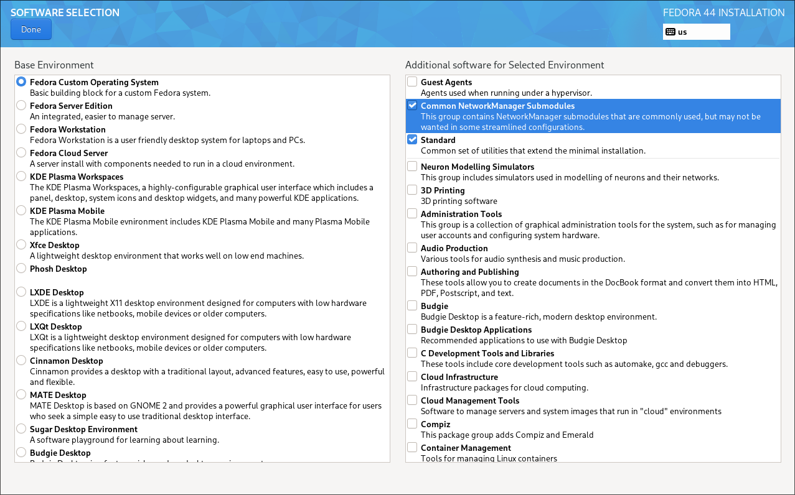

<p align="center">
  
  
  
</p>

<p align="center"><strong>iArch by Safari</strong> is maintained as a standalone GitHub repository, not as a fork of another GitHub repository.</p>

<div align="center">
<details>
  <summary><b>▶️ Click to view Video Trailer</b></summary>
  <br>
  <a href="https://www.youtube.com/watch?v=HJhm0aT3lNw">
    
  </a>
</details>
</div>


> **Safety and version note:** The original v5 Arch and Fedora installers make system-wide package, repository, service and login-manager changes. They are not the isolated v4 installer and have not been validated by this PR in a real session. Review [the v5 port status](docs/V5-PORT-STATUS.md) and the scripts before use. The isolated legacy-v4 session is available separately via [`legacy/install-v4-session.sh`](legacy/docs/V4-SESSION.md); it does not install Noctalia v5.

### Fresh Arch Install Requirement

**This configuration is tailored for a FRESH INSTALL of VANILLA ARCH LINUX using the archinstall script with the Hyprland profile.** In archinstall choose NetworkManager (default backend) and leave sddm as the greeter. The script will replace sddm for Noctalia-Greeter. We strongly advise against attempting this installation on derivative distributions (such as CachyOS, Manjaro, etc.) as package and configuration conflicts are highly likely.

## 🚀 Arch Installation Guide

### Prerequisites

```bash
sudo pacman -S git
```

### Step 1: Clone the Repository

Open your terminal and clone the repository using `git`:

```bash
git clone https://github.com/darksafari6/iarch-by-safari.git
```

### Step 2: Change directory to the repo
```bash
cd ./iarch-by-safari
```

### Step 3: Make the install script executable

```bash
chmod +x ./install.sh
```

### Step 4: Run the install script, YIPPE
```bash
sudo ./install.sh
```

### Fedora Installation 

<details>
  <summary align="center"><b>📸 Click to view Screenshot</b></summary>
  <p align="center">
    
  </p>
</details>

We recommend using a fresh install of Fedora using the Fedora Everything install ISO with package selections seen in the above screenshot.

The Fedora installer will enable the following COPR repositories to provide additional packages needed for the setup:

- [lionheartp/Hyprland](https://copr.fedorainfracloud.org/coprs/lionheartp/Hyprland/)
- [leloubil/wl-clip-persist](https://copr.fedorainfracloud.org/coprs/leloubil/wl-clip-persist/)
- [tofik/nwg-shell](https://copr.fedorainfracloud.org/coprs/tofik/nwg-shell/)

We are also using [Satty](https://github.com/gabm/Satty) for screen annotations. 

Credit goes to these developers for their excellent work.

To install on Fedora, follow these steps:

1. Install Git:
   ```bash
   sudo dnf install git -y
   ```

2. Clone the repository:
   ```bash
   git clone https://github.com/darksafari6/iarch-by-safari.git
   ```

3. Change into the project directory:
   ```bash
   cd iarch-by-safari
   ```

4. Make the Fedora installer executable:
   ```bash
   chmod +x ./fedora_install.sh
   ```

5. Run the Fedora installer:
   ```bash
   sudo ./fedora_install.sh
   ```


### Development Status

This script, is now released. It is no longer in beta state. This project originally started as a vibe coded project to see what we could get away with. It quickly turned into only being an outline, as A.I is too frustrating to deal with after more than 80 lines of code. The rest, is completely scripted by tonekneeo, and myself.

### Lua Update

The Hyprland configuration now uses Lua. The old `.conf`-based structure is no longer loaded; it lives under `legacy/config/hypr/` next to the rest of the frozen v4 payload, and nothing in the v5 session reads it.

We have also switched over to Noctalia v5.

### What this does

This script turns a fresh Arch + Hyprland or Fedora setup into an iArch by Safari desktop by installing required packages, dropping useless ones and adding preconfigured streamlined dotfiles.

### Nvidia Users

NVIDIA Users: On line 32 of the startup.lua change local enable_nvidia_optional = false to local enable_nvidia_optional = true

The script will prompt the user and update the startup.lua as needed.

### Credits and licenses

iArch by Safari is free software under the GPL-3.0 license; the complete text is in [LICENSE.txt](LICENSE.txt).

Every third-party project, artwork file and audio asset this product builds on is listed with its license and copyright holder in [THIRD_PARTY_NOTICES.md](THIRD_PARTY_NOTICES.md). That file is generated from [`branding/notices.json`](branding/notices.json):

```bash
python3 tools/notices.py --check    # CI: notices file matches its source
python3 tools/notices.py --write    # regenerate after editing notices.json
python3 tools/iarch_brand.py --check  # product naming is consistent
```

Upstream project names are deliberately kept out of the everyday UI. The bar, launcher, notifications, lock screen, greeter, terminal greeting and system information output say **iArch by Safari**. Credit lives in the notices file and, in the desktop, under Settings → About → Open-source licenses — that page is built in a later step and is tracked in [docs/ROADMAP.md](docs/ROADMAP.md), it does not exist yet.

### Community

Join the Discord server: [HERE](https://discord.gg/rQTabZmYHh)


## 📦 What's Included?

This repository provides comprehensive configurations for a complete, customized Hyprland desktop environment.

| Component | Description |
| :--- | :--- |
| **`hypr`** | Main Hyprland configuration, including keybinds, window rules, and workspace setup. **(Requires customization)** |
| **`kitty`** | Configuration for the primary GPU-accelerated terminal emulator. |
| **`fish`** | Configuration for the Fish shell, including custom functions and the Starship prompt. |
| **`Noctalia`** | The main bar, includes various theming settings, general use case settings. It's very much an all in one. |
| **`fastfetch`** | Configuration for displaying system information with custom images/ASCII art. |
| **`install.sh`** | An automated script for package installation and configuration deployment. |
| **`uninstall.sh`** | A script to revert changes and restore previous configurations (if a backup exists). |

---

## ✨ Glass Desktop Profile

The iArch by Safari glass profile adds an iPhone-inspired glass aesthetic to the session: a rounded translucent top bar, floating Control Center, a magnified dock, translucent Settings, top-right notification cards, and a custom dark/light palette. It keeps Linux-native services and permissions; unsupported hardware controls are not faked.

- Main profile: [`.config/noctalia/config.toml`](.config/noctalia/config.toml)
- Custom palette: [`.config/noctalia/palettes/iarch-midnight.json`](.config/noctalia/palettes/iarch-midnight.json)
- Architecture, backup, and recovery notes: [`docs/glass-experience.md`](docs/glass-experience.md)
- Read-only system diagnostics: run `bash scripts/iarch-healthcheck.sh` as your normal desktop user.

**Shortcuts:** `SUPER + I` opens Control Center; `SUPER + SHIFT + N` opens notification history; `SUPER + SHIFT + A` opens audio; `SUPER + SHIFT + W` opens network; `SUPER + SHIFT + B` opens Bluetooth. `SUPER + T` continues to open Settings.

The profile targets Noctalia v5+; Noctalia v4 uses a different configuration model. After applying a profile, run `noctalia config validate` and verify the live Wayland session before removing backups. See the [Noctalia v5+ configuration docs](https://docs.noctalia.dev/noctalia/configuration/) for configuration precedence and validation.

Notification sound is disabled in the profile by default; enabling it uses Noctalia's built-in Freedesktop sound theme at a restrained volume. GUI-managed overrides may take precedence. An arbitrary custom iPhone-style sound file is not wired up because a supported custom-file hook was not verified; this avoids introducing a conflicting notification daemon.

---

## 📚 Documentation

| Document | What it covers |
| :--- | :--- |
| [`docs/ARCHITECTURE.md`](docs/ARCHITECTURE.md) | Repository map, the two configuration payloads, runtime map, safety and performance contracts, testing map |
| [`docs/BRANDING.md`](docs/BRANDING.md) | Naming and credit policy, and the checklist for a new UI string |
| [`docs/ROADMAP.md`](docs/ROADMAP.md) | The six-part plan towards the fully glass session |
| [`docs/UNVERIFIED.md`](docs/UNVERIFIED.md) | Every claim that is not proven yet, with an id the code refers to |
| [`docs/glass-experience.md`](docs/glass-experience.md) | Glass profile behaviour, manual application and rollback |
| [`InstallNotes.md`](InstallNotes.md) | Long-form installation and troubleshooting notes |
| [`THIRD_PARTY_NOTICES.md`](THIRD_PARTY_NOTICES.md) | Third-party projects, artwork and audio assets, with licenses |

Historical documents ([`legacy/docs/V4-SESSION.md`](legacy/docs/V4-SESSION.md), [`legacy/docs/V4-INSTALL-NOTES.md`](legacy/docs/V4-INSTALL-NOTES.md), [`legacy/docs/GLASS-UI.md`](legacy/docs/GLASS-UI.md), [`docs/AUDIT.md`](docs/AUDIT.md), [`docs/STATUS-2.0.md`](docs/STATUS-2.0.md), [`docs/V5-PORT-STATUS.md`](docs/V5-PORT-STATUS.md)) describe the frozen legacy v4 session and past audits. They are marked with a banner and are not instructions for the current session.

---

## ⚙️ Customization Required

These dotfiles are provided strictly as a **template**. You **must** review and customize several files to align with your specific hardware, desired aesthetics, and system paths.

| File/Section | Customization Needed | Notes |
| :--- | :--- | :--- |
| **`hypr/monitors.lua`** | Monitor setup (resolution, scaling, refresh rate). | The current default is `monitor=,preferred,auto,1`. You may use `nwg-displays` to help configure and export precise settings. |
| **`hypr/keybind.lua`** | Set bindings here. | Super+E is to open your file explorer. Super+D is the app launcher. |
| **Theming** | Color schemes, fonts, and global aesthetic settings. | The default theme is minimal. Customize these within Noctalia's settings, go to color scheme, and then templates, you can set kitty, GTK, or whatever else you would like to match your color scheme. |
| *NOTE ON THEMING* | adw-gtk3-dark | This will be needed to make changes to GTK. This comes preinstalled, you will have to set it in GTK Settings. |
| **`fastfetch/config.jsonc`** | Theming/Images. | Update the configuration for your specific image or ASCII art display. |

---


### Additional Install Notes

For extra setup and troubleshooting details (including Arch ISO Wi-Fi setup before archinstall), see [InstallNotes.md](InstallNotes.md).


Note: The install.sh script handles package installation via your package manager and deploys the dotfiles. Any existing config files that would be overwritten are first backed up with a `.bak.<timestamp>` suffix in `~/.config`, allowing `uninstall.sh` to restore them later.

## 🗑️ Uninstallation
If you need to revert the changes, navigate to the repository directory and run:

```bash
./uninstall.sh
```

This will restore any backed-up config files found in `~/.config` to their previous state.

> **Note:** Installed packages are **not** automatically removed. If you wish to uninstall them, you will need to do so manually via your package manager.

## Deprecated isolated v4 session

The earlier independent Quickshell v4 session is deprecated and kept only for existing installs: `./legacy/install-v4-session.sh` and `./legacy/uninstall-v4-session.sh`, both marked as such in their headers. See [v4 session documentation](legacy/docs/V4-SESSION.md) and [v4 glass limitations](legacy/docs/GLASS-UI.md). It is separate from the v5 workflow and is not validated on a live system. For an existing v5 shell, the experimental backup-first profile helper is documented in [v5 port status](docs/V5-PORT-STATUS.md).
