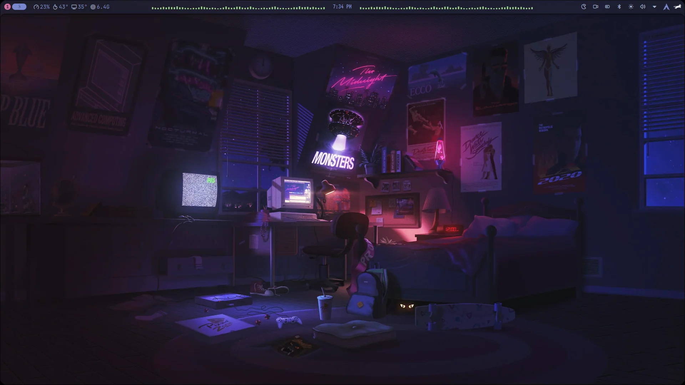
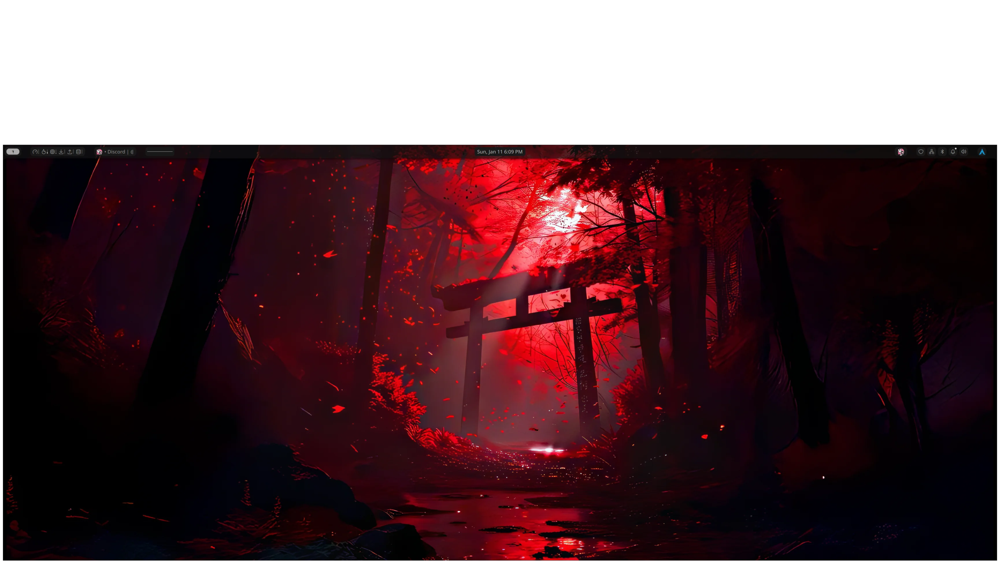

<p align="center">
  
</p>

# iArch by Safari

<p align="center">
  A glass Hyprland desktop for Arch Linux and Fedora: blurred translucent surfaces,
  real animation curves, and a settings app that writes your choices down instead of
  asking you to edit dotfiles. Built on Noctalia v5.
</p>

<p align="center">
  
  
  
  
</p>

## Screenshots

<p align="center">
  
  
</p>

The rest are placeholders until the part that builds them lands — a screenshot of
something that does not exist yet would just be a promise:

| Coming | What it will show | Planned in |
| :--- | :--- | :--- |
| Settings app | Glass GTK4 window editing your own settings | Part 4 |
| Shortcut overlay | The in-session key list, opened with Super+H | Part 7 |
| Preset switcher | Glass and Performance side by side | Part 5 |

A short video tour of the session is on YouTube: <https://www.youtube.com/watch?v=HJhm0aT3lNw>.

## Features

| Feature | What it does | Status |
| :--- | :--- | :--- |
| Glass surfaces | Blurred translucent bar, dock, Control Center, Settings and notifications; rounded corners, 2 px borders, inactive windows at 90% opacity | Ships today |
| Animations | Eight animation leaves on four hand-tuned bezier curves for window open, close, move, border, fade and workspace switches | Ships today |
| Keyboard shortcuts | 74 bindings, each with a description the compositor can report | Ships today |
| Shortcut overlay (Super+H) | Press a key, see every shortcut on screen | Key is reserved, overlay is Part 7 |
| Settings app | GTK4 + libadwaita window that edits `~/.config/iarch/`, regenerates your configuration and reloads the session | Part 4 |
| Presets | A lower-cost Performance overlay that only ever changes values of settings the shipped profile already has | CLI ships today (`tools/profile_preset.py`); switching in-session is later |
| Game mode | One switch that drops compositor effects for latency | Not built. The installer does offer a gaming package selection (Steam, MangoHud, Lutris, Proton tools) |
| Contact page | Your name, role and links, rendered by the settings app | Defaults ship in `data/contacts.default.json`; the page is Part 4 |

Honest summary: the session, the installers, the configuration data and the
checks are real. The settings app, the overlay and game mode are not built yet.
Everything this project claims but cannot yet prove is listed with an id in
[`docs/UNVERIFIED.md`](docs/UNVERIFIED.md), and the order of work is in
[`docs/ROADMAP.md`](docs/ROADMAP.md).

## Requirements

**A fresh install, not a rescue.** Both installers change system-wide packages,
repositories, services and the login manager.

- **Arch Linux:** a fresh vanilla Arch install made with `archinstall`, choosing the
  **Hyprland** profile. Keep NetworkManager (the default backend) and leave **sddm**
  as the greeter — the installer replaces it with the Noctalia greeter on greetd.
  Derivatives such as CachyOS or Manjaro are likely to conflict with the package
  and configuration sets this session expects.
- **Fedora:** a fresh Fedora install from the Everything ISO, with the package
  selections shown in
  [`assets/screenshots/fedora-install-selection.png`](assets/screenshots/fedora-install-selection.png).
  The installer enables three COPR repositories for Hyprland, wl-clip-persist and
  nwg-shell.
- **Privileges:** you run the installer with `sudo`. Read
  [`SECURITY.md`](SECURITY.md) first — it lists every privileged operation with
  the line it happens on.
- **Hardware:** blur and transparency cost GPU time. NVIDIA users set
  `enable_nvidia_optional = true` in `.config/hypr/startup.lua`, or accept the
  installer's prompt to do it.

## Install

```bash
sudo pacman -S git                                  # Arch
git clone https://github.com/darksafari6/iarch-by-safari.git
cd iarch-by-safari
sudo ./install.sh
```

On Fedora, the same three steps with `sudo dnf install git -y` and
`sudo ./fedora_install.sh`.

Both scripts are interactive: they ask about a default install, NVIDIA, printer
support, gaming packages, which packages to remove, browser, audio stack and
whether to reboot. Every file they replace is backed up first with a
`.bak.<timestamp>` suffix, and additions are recorded so nothing is removed
silently later.

**`--dry-run` does not exist yet.** It is scheduled for Part 6, together with the
rest of the installer hardening (the `--noconfirm` package installs, the
`/etc/pacman.conf` edits and the display-manager switch). Until then, the way to
see what will happen is to read the script and [`SECURITY.md`](SECURITY.md), and
to run it on a machine you can reinstall.

## Shortcuts

The full table is in [`docs/SHORTCUTS.md`](docs/SHORTCUTS.md). It is generated
from the session's own keybind file, so it cannot drift from what your keyboard
actually does:

```
.config/hypr/keybind.lua  →  data/keybinds.default.json  →  docs/SHORTCUTS.md
        (tools/extract_keybinds.py)      (tools/render_shortcuts.py)
```

The ones worth knowing first:

| Keys | What it does |
| :--- | :--- |
| `SUPER + RETURN` | Terminal |
| `SUPER + D` | Application launcher |
| `SUPER + I` | Control Center |
| `SUPER + T` | Settings |
| `SUPER + L` | Lock screen |
| `SUPER + 1`–`0` | Switch workspace (`SUPER + SHIFT + 1`–`0` moves the window) |
| `SUPER + A` | Annotate a screenshot |
| `SUPER + H` | Shortcut overlay — reserved, not bound yet |

## Customization

Your settings live in `~/.config/iarch/`, and the repository ships the defaults
they are merged over in [`data/`](data/). After installing, you edit your copy,
never the checkout — an edit to the repository is lost at the next update.

| To change | Edit |
| :--- | :--- |
| Monitors, resolution, scaling | `.config/hypr/monitors.lua` |
| Keybindings | `.config/hypr/keybind.lua`, then `python3 tools/extract_keybinds.py --write` |
| Border, rounding, gaps, blur, opacity | `.config/hypr/themes/theme.lua` |
| Shell colours | `.config/noctalia/palettes/iarch-midnight.json` |
| Terminal colours and font | `.config/kitty/` and `.config/starship.toml` |
| System information layout | `.config/fastfetch/config.jsonc` |

Files that begin `-- GENERATED BY iArch. DO NOT EDIT.` are written by the
generators from your settings; editing them directly is how work gets lost. The
rules — atomic writes, five rotating backups, what may be edited by hand — are in
[`docs/ARCHITECTURE.md`](docs/ARCHITECTURE.md).

To try the lower-cost preset and roll it back:

```bash
python3 tools/profile_preset.py apply performance --config ~/.config/noctalia/config.toml
python3 tools/profile_preset.py revert --config ~/.config/noctalia/config.toml
```

## Uninstall and rollback

```bash
./uninstall.sh
```

It restores the timestamped backups it finds in `~/.config` and tells you which
files it restored and which it deliberately left alone. Generated files also keep
their last five versions under `~/.local/state/iarch/backups/`.

What it does **not** do: remove packages, disable services it enabled, undo the
repository changes in `/etc/pacman.conf` or the COPRs, or put your old display
manager back. Those are listed in the installer output and in
[`SECURITY.md`](SECURITY.md), and reverting them is manual by design.

## Troubleshooting

| Symptom | What to do |
| :--- | :--- |
| Nothing to check against | `bash scripts/iarch-healthcheck.sh` reports the shell, compositor and audio without changing anything |
| Black screen or no login prompt after install | Switch to a TTY, then `sudo systemctl disable greetd && sudo systemctl enable sddm` |
| Shell looks wrong or refuses a setting | Run `noctalia config validate`; GUI overrides in `~/.local/state/noctalia/settings.toml` win over the shipped profile |
| Terminal font or cursor theme is not what the config says | Neither installer provides `JetBrainsMono Nerd Font Mono` yet (`TP-13`), so the terminal falls back to a system monospace. Bibata is installed on Arch (`install.sh:424`) and added on Fedora, its name unverified (`TP-18`). Install a Nerd Font package, or let the defaults stand |
| Screen does not lock by itself | `hypridle` is installed but not started by `startup.lua`; `SUPER + L` locks immediately |
| A shortcut does nothing | Check it in [`docs/SHORTCUTS.md`](docs/SHORTCUTS.md) — reserved keys are listed as not bound yet |
| Something else | [`InstallNotes.md`](InstallNotes.md) has the long-form notes, including Arch ISO Wi-Fi before `archinstall` |

Please open an issue with the output of the healthcheck script. Hardware
differences are the main source of unproven claims here, so a report from a real
machine closes one.

## Credits & License

iArch by Safari is licensed under GPL-3.0; the complete text is in
[`LICENSE.txt`](LICENSE.txt). It builds on open-source projects, each credited with
its license and copyright holder in [`THIRD_PARTY_NOTICES.md`](THIRD_PARTY_NOTICES.md).

It began as Safari's personal Arch dotfiles, published earlier on GitLab under the
names minimaLinux and minimaDots. This repository is that same continuing work
under its current name; the older names survive only as identifiers other programs
match on and in the historical documents under [`legacy/`](legacy/).

| | |
| :--- | :--- |
| How the repository is organised | [`docs/ARCHITECTURE.md`](docs/ARCHITECTURE.md) |
| Contributing, and the checks to run | [`CONTRIBUTING.md`](CONTRIBUTING.md) |
| Reporting a security problem | [`SECURITY.md`](SECURITY.md) |
| What changed, newest first | [`CHANGELOG.md`](CHANGELOG.md) |
| Claims not proven yet | [`docs/UNVERIFIED.md`](docs/UNVERIFIED.md) |
| The frozen legacy v4 session | [`legacy/docs/V4-SESSION.md`](legacy/docs/V4-SESSION.md) |
