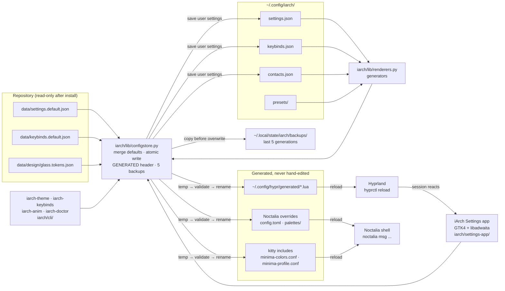

# Architecture and repository layout

iArch by Safari is a Hyprland desktop session for Arch Linux and Fedora: dotfiles,
installers, runtime helpers and the tooling that keeps them honest. This document is
the map. Read it before changing anything.

- Naming and credit policy: [BRANDING.md](BRANDING.md)
- Claims that are not proven yet: [UNVERIFIED.md](UNVERIFIED.md)
- What is being built next: [ROADMAP.md](ROADMAP.md)
- Glass profile behaviour and recovery: [glass-experience.md](glass-experience.md)

## Repository layout

```
.
├── README.md                 Entry point for users: install, customize, uninstall.
├── InstallNotes.md           Long-form install and troubleshooting notes.
├── LICENSE.txt               GPL-3.0 license for this repository. Never edit or remove.
├── THIRD_PARTY_NOTICES.md    Generated. Third-party credit; edit branding/notices.json instead.
│
├── .config/                  The v5 session payload only (see "Two payloads" below).
│   ├── hypr/                 Compositor configuration, Lua API only -- with two exceptions.
│   │   ├── generated/glass.lua       Rendered from the design tokens; never edited.
│   │   ├── generated/animations.lua  Rendered from the motion tokens; never edited.
│   │   ├── hyprlock.conf     Rendered lock screen. hyprlock is its own binary and searches
│   │   │                     for this exact filename, which is why a generated file sits
│   │   │                     beside the Lua payload instead of under generated/.
│   │   └── hypridle.conf     Rendered idle fallback, shipped UNLAUNCHED: the shell already
│   │                         watches ext_idle_notifier_v1. See glass-experience.md.
│   ├── noctalia/             Shell configuration: config.toml + palettes/.
│   ├── fastfetch/            System information layout and artwork.
│   ├── kitty/                Terminal configuration and generated color/profile includes.
│   ├── fish/                 Interactive shell configuration, including the greeting.
│   └── starship.toml         Prompt configuration.
│
├── branding/                 Product identity, machine-readable.
│   ├── product.env           The only definition of the product name, ids and runtime paths.
│   └── notices.json          The only definition of third-party credit.
│
├── iarch/                    The product's own code, all of it iarch-prefixed.
│   ├── lib/configstore.py    User state: defaults merge, atomic writes, backups. The rules below.
│   ├── lib/renderers.py      Generators. Contract shipped; renderers land in Parts 2 and 5.
│   ├── lib/modes.py          Mode switches: the compositor and shell calls, the modes.<name>
│   │                         record, and the matches/differs/unverified vocabulary both share.
│   ├── cli/                  iarch-theme (Part 2), iarch-anim, iarch-doctor, iarch-gamemode and
│   │                         iarch-focus (Part 3); iarch-keybinds (Part 5).
│   │   ├── contrast_check.py  WCAG gate every preset clears; iarch-theme refuses failures.
│   │   ├── gen_wallpapers.py  Seeded 4K WebP renders of the generated presets.
│   │   ├── gen_glass_lua.py   Hyprland decoration, layer and window rules from the tokens.
│   │   ├── gen_animations_lua.py  Hyprland curves and animation leaves from a motion preset.
│   │   ├── render_noctalia.py Shell config.toml and one palette per preset, from the same tokens.
│   │   ├── render_hyprlock.py The lock screen and the unlaunched idle fallback, from the same
│   │   │                      tokens: hyprlock's blur *is* the intensity's blur recipe.
│   │   ├── render_gtk_css.py  The GTK 4 and GTK 3 glass overlays, from templates in lib/templates.
│   │   ├── render_kvantum.py  The Qt/Kvantum glass theme, recoloured from the presets.
│   │   ├── gen_fontconfig.py  The fontconfig file that applies the font tokens.
│   │   ├── theme.py           iarch-theme: one preset across every surface above; gates on contrast.
│   │   ├── iarch_anim.py      iarch-anim: switch the motion preset, speed, reduce-motion and
│   │   │                      per-event overrides; verifies with the compositor and rolls back.
│   │   ├── iarch_doctor.py    iarch-doctor: ask a running session whether it took the settings --
│   │   │                      notifications in Part 3, the rest of the session in Part 5.
│   │   ├── iarch_gamemode.py  iarch-gamemode: run iarch-theme and iarch-anim as one switch, save
│   │   │                      the state they replaced, and read four leaves back to check.
│   │   └── iarch_focus.py     iarch-focus: Do Not Disturb, caffeine and a runtime dim on every
│   │                          unfocused window. Writes no file, so a reload ends it.
│   └── settings-app/         GTK4 + libadwaita settings application (Part 4).
│
├── data/                     Repository defaults. A user never edits these after install.
│   ├── settings.default.json Default effects, preset and theme selection.
│   ├── keybinds.default.json Keyboard map, extracted from .config/hypr/keybind.lua.
│   ├── contacts.default.json Contact page defaults for the Part 4 settings app.
│   ├── design/               Glass design tokens and the six colour presets.
│   │   ├── tokens.json     Radii, spacing, motion, blur per intensity, class groups.
│   │   ├── noctalia.json   The shell settings that exist upstream, with their types and bounds.
│   │   ├── hyprlock.json   The hyprlock and hypridle variables, types, defaults and enumerations.
│   │   ├── greeter.json    The login screen: greetd, greeter.toml, sync.toml and what Sync carries.
│   │   ├── gtk.json        The GTK 4 and GTK 3 CSS each version really parses, kept apart.
│   │   ├── kvantum.json    The Kvantum theme keys, types and integer bounds, from the parser.
│   │   ├── fontconfig.json The fontconfig XML elements and attributes the DTD declares.
│   │   ├── animations.json The Hyprland animation leaves, per-leaf styles and curve shapes.
│   │   ├── animations/     Five motion presets: named curves and per-event durations and styles.
│   │   └── presets/        Six palettes; each must clear the WCAG gate to apply.
│   ├── schemas/              JSON Schema for every file above; CI validates defaults against them.
│   └── licenses.json         Generated third-party credit, read by Settings → About.
│
├── profiles/                 Effect presets applied on top of the shipped shell profile.
│   └── performance.toml      Overlay: same keys, lower cost. See "Performance contract".
│
├── lib/                      Shell libraries sourced by the installers.
│   ├── iarch-common.sh       Logging, timestamped backups, safe install, user resolution.
│   ├── managed-files.sh      Classifies an installed system file before touching it.
│   ├── package-audit.sh      Records which packages an install added. Never removes any.
│   └── stage-v5-config.sh    Builds the v5-only payload in a caller-owned empty directory.
│
├── tools/                    Python helpers. Stdlib only; no desktop is started by tests.
│   ├── iarch_brand.py        Reads branding/product.env; validates naming consistency.
│   ├── notices.py            Renders and checks THIRD_PARTY_NOTICES.md and data/licenses.json.
│   ├── branding_lint.py      Fails when the everyday UI shows an upstream or previous name.
│   ├── naming_audit.py       Repo-wide search for previous names, against a reasoned allowlist.
│   ├── extract_keybinds.py   Renders data/keybinds.default.json out of keybind.lua.
│   ├── render_shortcuts.py   Renders docs/SHORTCUTS.md out of that data.
│   ├── profile_preset.py     Applies or reverts an effect preset, backup first.
│   ├── preflight.py          Read-only host checks before an install.
│   ├── diagnose.py           Read-only session diagnostics (legacy v4 session).
│   ├── recover_session.py    Lists and restores session backups (legacy v4 session).
│   ├── glass_preset.py       Experimental glass preset for the legacy v4 session.
│   └── v5_profile.py         Stages the shell profile or restores an explicit backup.
│
├── scripts/                  Runtime helpers a user runs inside the session.
│   ├── iarch-healthcheck.sh  Read-only diagnostics; changes nothing.
│   └── iarch-control-center.sh  Allowlisted IPC shortcuts for the shell.
│
├── pipewire/                 Optional virtual-surround convolver profile and HRIR assets.
├── assets/
│   ├── branding/             The original logo artwork, colour and mono.
│   ├── screenshots/          Small UI captures used by README and docs.
│   └── wallpapers/           WebP renditions of the desktop showcase art (quality 85, 3840 px
│                             ceiling); originals/ keeps the lossless PNG sources and the note.
├── docs/                     This directory.
├── tests/                    Shell and Python tests. See "Testing map".
├── CONTRIBUTING.md           How to work on this repository.
├── CHANGELOG.md              What changed, newest first.
├── SECURITY.md               How to report a problem, given privileged installers.
│
├── install.sh                Arch installer: system-wide, root, fresh install.
├── fedora_install.sh         Fedora installer: system-wide, root, fresh install.
├── uninstall.sh              Restores timestamped backups; never deletes an active config.
│
└── legacy/                   The frozen v4 payload and its two deprecated scripts.
    ├── install-v4-session.sh Deprecate-on-sight installer for the isolated legacy session.
    ├── uninstall-v4-session.sh Removes only the managed launchers of that session.
    ├── session/              Wayland session launchers and menu entries of the v4 session.
    ├── config/               The v4 payload: Hyprlang *.conf, GTK 3/4 settings, the v4
    │                         noctalia settings/plugins and the frozen customization center.
    └── docs/                 Historical v4 session and glass documents.
```

## Two payloads

The repository carries two mutually incompatible configuration sets. Mixing them is the
single easiest way to break a session, so every installer stages exactly one.

| | Current session (v5) | Legacy isolated session (v4) |
| --- | --- | --- |
| Compositor config | `.config/hypr/*.lua` (Lua API) | `legacy/config/hypr/*.conf` (Hyprlang) |
| Shell config | `.config/noctalia/config.toml` + `palettes/*.json` | `legacy/config/noctalia/settings.json` + `plugins/` |
| IPC used by keybinds | `noctalia msg ...` | `qs -c noctalia-shell ipc call ...` |
| Deployed by | `install.sh`, `fedora_install.sh` via `lib/stage-v5-config.sh` | `legacy/install-v4-session.sh` (stages `.config` and `legacy/config`) |
| Config root | `~/.config` | `~/.config/minimalinux` (its own `XDG_CONFIG_HOME`) |
| Status | Supported | Frozen. Kept working, not developed further |

`lib/stage-v5-config.sh` is the boundary: it copies an explicit allowlist of v5 paths and
fails if one is missing, so a v4 file can never reach a v5 install. `tests/test_v5_staging.py`
proves the exclusion in both directions.

### Frozen legacy identifiers

The legacy session keeps the identifiers other programs match on, even though they carry the
previous product name:

- the path `~/.config/minimalinux` and the launcher names `minimalinux-session`, `minimalinux-customize`;
- the marker line `# Managed by minimaLinux session installer` that `lib/managed-files.sh` uses to
  decide whether a system file is safe to replace or remove;
- the generated include names `kitty/minima-colors.conf` and `kitty/minima-profile.conf`;
- comments written into generated configuration files.

Renaming any of these would orphan already-installed systems: the marker would stop matching,
so the installer and the uninstaller would refuse to manage their own files. What a person reads
on screen (session menu entries, window titles, labels, CLI output) is rebranded; what a program
matches on is not. `tools/branding_lint.py` encodes that line.

## Runtime map

```
display manager (greetd) ──> Hyprland ──> .config/hypr/hyprland.lua
                                              ├── monitors.lua   displays and scaling
                                              ├── startup.lua    environment, autostart, shell launch
                                              ├── inputs.lua     keyboard and pointer
                                              ├── keybind.lua    every shortcut, each with a description
                                              ├── windowrules.lua  per-application rules
                                              ├── animations.lua  static curves, then generated/animations.lua
                                              └── themes/theme.lua  accent colors
                                                        │
                                                        └──> shell process (bar, dock, launcher,
                                                             Control Center, notifications, Settings,
                                                             lock screen, idle) driven by `noctalia msg ...`
                                                                      │
                          scripts/iarch-control-center.sh ────────────┘  allowlisted IPC shortcuts
                          scripts/iarch-healthcheck.sh ─── read-only probe of shell, compositor, audio

hyprlock (.config/hypr/hyprlock.conf) is the *other* session-lock client, and only one can hold
ext_session_lock_v1 at a time. The shell wins whenever it is running, so hyprlock is the lock
screen for a session without the shell -- which is also why hypridle.conf ships unlaunched and
declares no listener: a second idle daemon would race the shell's [idle.behavior.*] timers.
```

Keybind descriptions in `keybind.lua` are the data source for the shortcut overlay planned in
[ROADMAP.md](ROADMAP.md). Keep them short, accurate and free of upstream names; the lint checks
all three. `python3 tools/extract_keybinds.py --write` regenerates `data/keybinds.default.json`
from that Lua file, and `--check` is how CI proves the two agree.

## User state and the single source of truth

One rule decides where a byte lives: **the repository ships defaults, the user owns settings, and
every file a program writes is generated.** Nothing in between is allowed.

| Layer | Location | Who writes it | May a user edit it? |
| --- | --- | --- | --- |
| Repository defaults | `data/*.default.json`, `data/design/` | This repository | No, not after install — an edit is lost on the next update |
| User settings | `~/.config/iarch/` (`settings.json`, `keybinds.json`, `contacts.json`, `presets/`) | The settings app, or the user | Yes — this is the only configuration anyone edits |
| Generated files | `~/.config/hypr/generated/*.lua`, Noctalia overrides, kitty includes | The generators in `iarch/cli/`, and `iarch-theme` which drives them, under the contract in `iarch/lib/renderers.py` | No — they carry the GENERATED header and are rewritten wholesale |
| Backups | `~/.local/state/iarch/backups/` | `iarch/lib/configstore.py` | No — read them only to roll back |
| Mode state | `~/.config/iarch/settings.json` under `modes.<name>` | `iarch/lib/modes.py`, from `iarch-gamemode` and `iarch-focus` | Yes, though `--forget` is the supported way to clear a record |

A mode switch is not a fourth kind of writer. It composes values that already
exist — an intensity, a motion preset, two decoration leaves — and adds only the
round trip: read the state, record it, apply it, verify it, restore it. So
`iarch-gamemode` renders nothing itself and `iarch-focus` writes no file at all,
and the record under `modes.<name>` is the only new byte either one owns. That is
also why the record has to be read from the user's file rather than from the
merged document `configstore.load` returns: with the repository defaults merged
underneath, "never switched on" and "matches the default" are the same object, and
a mode that cannot tell them apart cannot be turned off.

Rules every generator obeys, implemented once in `iarch/lib/configstore.py` and proven by
`tests/test_config_store.py`:

1. **Merge, never fork.** Loading a name reads `data/<name>.default.json` and merges the user's
   file on top, so a new default appears for everyone without anyone re-editing settings, and a
   user's own values always win.
2. **Stamp generated output.** Every generated file begins with
   `-- GENERATED BY iArch. DO NOT EDIT. Change settings in iArch Settings.`
   (the same sentence with `#` in shell, TOML and fish files, and as the first `_generated` key in
   JSON, which has no comment syntax). A generator refuses to overwrite a file that lacks the
   stamp — that is how a user's hand-written configuration stays theirs.
3. **Write atomically, always.** Temp file in the destination directory → validate → `os.replace`.
   A crash mid-write leaves the previous file intact, never a half-written session.
4. **Keep the last five backups.** Before overwriting, the previous file is copied to
   `~/.local/state/iarch/backups/` with a sortable timestamp, and the directory is trimmed to five
   generations. `uninstall.sh` and `tools/profile_preset.py revert` read from there.
5. **Never write inside the repository at runtime.** `IARCH_CONFIG_DIR` and `IARCH_STATE_DIR`
   relocate both roots, which is also how the tests run without touching a real home directory.
6. **A surface record may exist with no generator behind it.** `data/design/greeter.json` records
   the whole login screen — greetd's two tables, the greeter's declarative `greeter.toml`, the
   mutable `sync.toml`, what Sync carries and what it cannot — and nothing is generated from it.
   The file it describes is root-owned, wins over Sync for every key it sets, only ever warns about
   a value it dislikes, and is mostly machine facts: a connector name, an account name, a cursor
   theme directory. A record like that exists to make an absence checkable rather than assumed.
7. **A withheld key says so.** When upstream really does declare a setting and this project
   deliberately does not emit it, the section's `withheld` map carries the reason, the record that
   covers it and the citation, so a validator can say "withheld on purpose" instead of claiming the
   pinned release has no such setting. `[shell] polkit_agent` and `[shell.greeter_sync]` are the two
   today, and the first version of that message was false about both.



The loop closes on purpose: the settings app reads back what the compositor now runs, so the UI
can never claim a value the session does not have.

## Safety contract

Rules every script in this repository is held to. Deviations that exist today are listed in
[UNVERIFIED.md](UNVERIFIED.md) with an `INS-` id and are scheduled work, not accepted behaviour.

1. **Back up before overwriting**, with a timestamped suffix (`.bak.<timestamp>`), and verify the
   backup destination is free before moving anything. `lib/iarch-common.sh` implements this once.
2. **Idempotent by default.** Running a script twice must not duplicate work or destroy the first
   run's result. Skipping an unchanged file is a success, not a no-op to hide.
3. **Never `chown -R` a whole config tree.** Ownership changes are limited to paths this repository
   actually deployed.
4. **Never remove packages silently.** Removals are listed, explained and explicitly approved, and
   additions are recorded by `lib/package-audit.sh`.
5. **Never `curl | bash`.** Every script is read from the checkout the user inspected.
6. **Never pass `--noconfirm` for an unreviewed AUR package.**
7. **Refuse ambiguous targets.** Symlinks, files whose content differs from the shipped source, and
   unmanaged paths are reported and left alone rather than overwritten.
8. **Fail closed and say where the backup is.** A partial operation must tell the user what changed
   and how to get back.

## Performance contract

Every visual effect must be switchable, and a lower-cost preset must always exist.

- The shipped profile (`.config/noctalia/config.toml`) is the default "glass" look.
- `profiles/performance.toml` is an overlay that changes **values only**, never keys:
  `tools/profile_preset.py` rejects any overlay path that does not already exist in the base
  profile, which is what makes inventing configuration keys impossible.
- Applying a preset backs up first, validates, and can be reverted
  (`tests/test_profile_preset.py` covers all three, including the refusal paths).
- No preset may claim a measured gain until it has one; see `PERF-01` in [UNVERIFIED.md](UNVERIFIED.md).

## Testing map

| Command | Proves |
| --- | --- |
| `python3 -m unittest discover -s tests -p 'test_*.py'` | All Python-level logic: naming, notices, lint, staging, presets, the config store, keybind and shortcut data, README structure, data schemas, reference integrity, installer CLI, recovery, diagnostics |
| `./tests/session-install.sh` | The legacy session installer against a mocked filesystem and mocked sudo |
| `./tests/managed-files.sh` | System-file classification (absent, identical, symlink, unmanaged, modified) |
| `./tests/package-audit.sh` | Package-addition recording, with no removal path |
| `python3 tools/notices.py --check` | Both credit files match `branding/notices.json` |
| `python3 tools/iarch_brand.py --check` | Product naming is consistent and referenced files exist |
| `python3 tools/branding_lint.py` | Everyday-UI surfaces carry no previous product or upstream shell name |
| `python3 tools/naming_audit.py --check` | Old names survive only in allowlisted files, each with a recorded reason |
| `python3 tools/extract_keybinds.py --check` | `data/keybinds.default.json` still matches `keybind.lua` |
| `python3 tools/render_shortcuts.py --check` | `docs/SHORTCUTS.md` still matches the keybind data |
| `python3 iarch/cli/contrast_check.py --quiet` | Every preset clears 4.5:1 for text and 3:1 for non-text UI |
| `python3 iarch/cli/gen_wallpapers.py --check` | Generated wallpapers exist, are 4K WebP and inside 600 KB; nothing orphaned |
| `python3 iarch/cli/gen_glass_lua.py --check` | The committed `glass.lua` still matches a fresh render of the tokens |
| `python3 iarch/cli/gen_animations_lua.py --check` | The committed `animations.lua` still matches a fresh render of the default intensity's motion preset |
| `python3 iarch/cli/render_noctalia.py --check` | The committed `config.toml` and all six palettes still match a fresh render |
| `python3 iarch/cli/render_hyprlock.py --check` | The committed `hyprlock.conf` and `hypridle.conf` still match a fresh render |
| `python3 iarch/cli/render_gtk_css.py --check --repo` | The committed GTK 4 and GTK 3 sheets still match a fresh render |
| `python3 iarch/cli/render_kvantum.py --check` | The committed Kvantum pointer and theme still match a fresh render |
| `python3 iarch/cli/gen_fontconfig.py --check` | The committed `fonts.conf` still matches a fresh render |
| `bash -n <script>` | Shell syntax of every script |
| `shellcheck --severity=warning <script>` | Shell quality; `.shellcheckrc` states the dialect and lists every exception with its reason |

CI runs all of the above in `.github/workflows/iarch-checks.yml`, as a non-root
user, plus JSON Schema validation of everything in `data/`, TOML validation of
`.config/noctalia/*.toml` and `profiles/*.toml`, a check that no gitlink or
submodule crept in, and a final `git diff --exit-code` proving that running the
checks does not modify a tracked file.

What no test here proves: a real Arch or Fedora install, a live Hyprland session, GPU behaviour,
audio hardware, package availability, or how the shell actually renders. Those need a machine and
are tracked in [UNVERIFIED.md](UNVERIFIED.md). Tests use temporary directories and mocks; they
never touch `~/.config`, never call a package manager and never start a session.

## Documentation set

| Document | Status |
| --- | --- |
| [ARCHITECTURE.md](ARCHITECTURE.md) | Current. This file |
| [BRANDING.md](BRANDING.md) | Current. Naming and credit policy |
| [MOTION.md](MOTION.md) | Current. Animation presets, hover/press/focus, reduce motion, and the QA walk-through |
| [ROADMAP.md](ROADMAP.md) | Current. The six-part glass plan |
| [UNVERIFIED.md](UNVERIFIED.md) | Current. Open verification items |
| [glass-experience.md](glass-experience.md) | Current. Glass profile and recovery |
| [V4-SESSION.md](../legacy/docs/V4-SESSION.md), [V4-INSTALL-NOTES.md](../legacy/docs/V4-INSTALL-NOTES.md) | Historical. Legacy isolated session |
| [GLASS-UI.md](../legacy/docs/GLASS-UI.md) | Historical. Legacy v4 glass preset audit |
| [AUDIT.md](AUDIT.md), [STATUS-2.0.md](STATUS-2.0.md) | Historical. Repository and installer audit |
| [V5-PORT-STATUS.md](V5-PORT-STATUS.md) | Historical. Port status between the two payloads |

Historical documents are kept because they record why the current safety rules exist. They are
marked with a banner and are not instructions for today's session.
